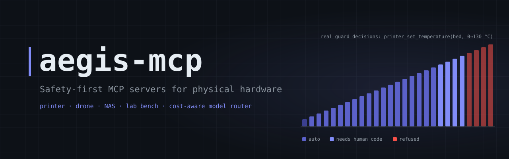
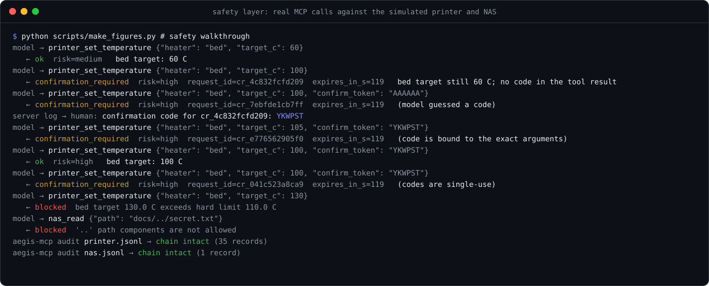
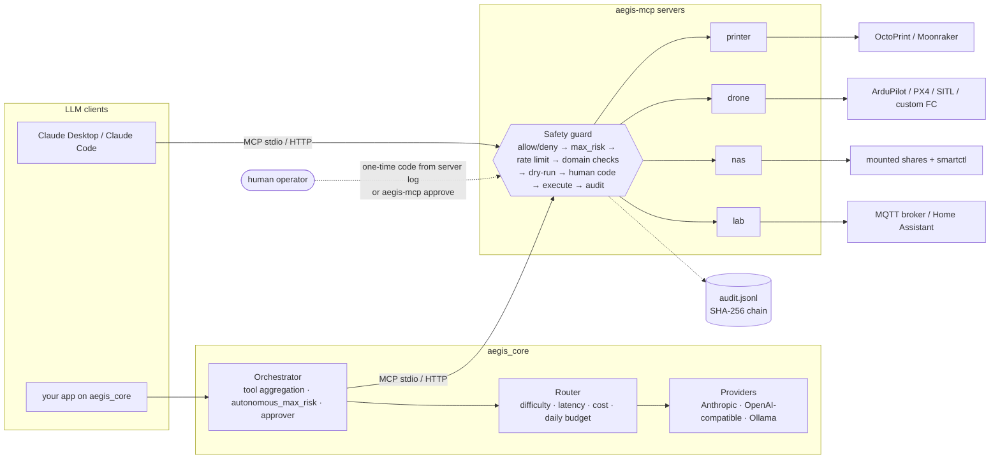
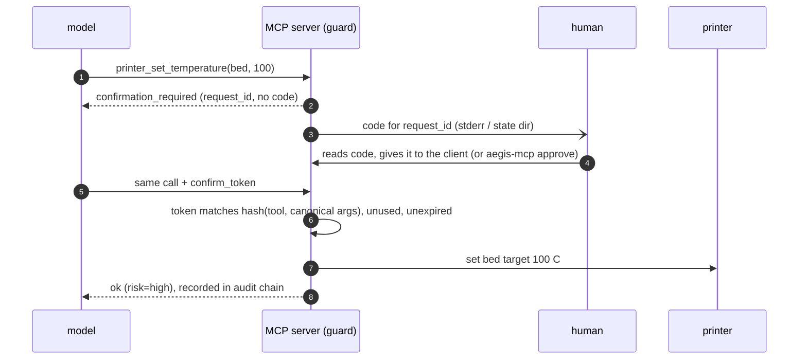
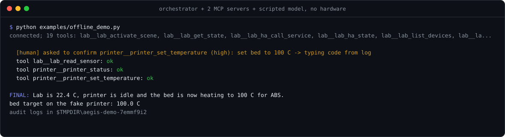
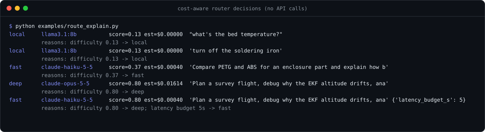

<p align="center">
  
</p>

<p align="center">
  <a href="https://github.com/coopersimpson101-debug/aegis-mcp/actions/workflows/ci.yml"></a>
[](https://github.com/coopersimpson101-debug/aegis-mcp/releases/latest)
  <a href="LICENSE"></a>
  
  <a href="https://modelcontextprotocol.io"></a>
  
</p>

**Let an AI assistant run your 3D printer, drone, NAS and lab bench without letting it burn, crash or delete
anything.** aegis-mcp is a set of [Model Context Protocol](https://modelcontextprotocol.io) servers for physical
hardware that share one safety layer. Dangerous calls need a one-time code from a human, and the model can never
see or forge that code. The package also ships `aegis_core`, a cost-aware model router and multi-server
orchestrator.

<p align="center">
  <a href="#quickstart">Quickstart</a> ·
  <a href="#architecture">Architecture</a> ·
  <a href="#tool-reference">Tool reference</a> ·
  <a href="docs/safety-model.md">Safety model</a> ·
  <a href="#status">Status</a> ·
  <a href="docs/simulators.md">Simulators</a> ·
  <a href="docs/architecture.md">Design notes</a>
</p>

<p align="center">
  
  <br>
  <sub>Real MCP calls against the in-repo OctoPrint simulator and a temporary NAS root. The bed stays at 60 C
  until the human's code arrives. Regenerate with <code>python scripts/make_figures.py</code>
  (text capture: <a href="docs/assets/safety_walkthrough.txt">safety_walkthrough.txt</a>).</sub>
</p>

## Highlights

- **4 MCP servers, 38 tools:** printer (OctoPrint, Moonraker/Klipper), drone (MAVLink: ArduPilot/PX4/SITL, or
  the AEGIS-Link serial protocol), NAS (any mount, `smartctl`, TrueNAS/Synology), lab (MQTT, Home Assistant).
  They work with any MCP client: Claude Desktop, Claude Code or your own agent.
- **Risk is computed per call, not per tool.** A 60 C bed is `medium`, 100 C is `high` and needs a human,
  and 130 C is refused (defaults: confirm above 90 C, hard max 110 C).
- **Confirmation codes are bound to the exact arguments.** Each code is single-use and expires after 2 minutes.
  A code for "bed 100 C" cannot approve "bed 105 C". The code goes to the server log, never into the tool
  result, and the orchestrator strips any `confirm_token` the model invents.
- **Domain guards:** a geofence on takeoff and goto, scanning of uploaded G-code for peak temperatures,
  path-traversal-proof NAS roots (including symlink escapes), allowlists, rate limits and dry-run mode.
- **Safe exits stay reachable.** `drone_land`, `drone_rtl`, `printer_pause`, heater off and outlet off are all
  low risk.
- **Tamper-evident audit:** a SHA-256 hash-chained JSONL log with secrets redacted, which `aegis-mcp audit`
  verifies.
- **A cost-aware router:** local Ollama → Haiku → Sonnet → Opus chosen by difficulty, latency budget and
  daily spend, with escalation on errors or low confidence.

## Quickstart

**Claude Desktop**: add the servers to `claude_desktop_config.json` (full example:
[examples/claude_desktop_config.json](examples/claude_desktop_config.json)):

```json
{
  "mcpServers": {
    "aegis-printer": {
      "command": "aegis-mcp-printer",
      "args": ["--config", "/path/to/config/printer.toml"],
      "env": { "AEGIS_PRINTER_API_KEY": "<your key>" }
    },
    "aegis-nas": {
      "command": "aegis-mcp-nas",
      "args": ["--root", "media=/mnt/tank/media", "--root", "docs=/mnt/tank/docs"]
    },
    "aegis-drone": {
      "command": "aegis-mcp-drone",
      "args": ["--config", "/path/to/config/drone.toml", "--dry-run"]
    }
  }
}
```

**Claude Code** (project-scoped `.mcp.json` example: [examples/claude_code_mcp.json](examples/claude_code_mcp.json)):

```bash
claude mcp add aegis-nas -- aegis-mcp-nas --root docs=/mnt/tank/docs
claude mcp add aegis-printer -e AEGIS_PRINTER_API_KEY=<key> -- aegis-mcp-printer --config config/printer.toml
claude mcp add --transport http aegis-lab http://127.0.0.1:8004/mcp     # a server running over streamable HTTP
```

**Install and try it with no hardware and no API key:**

```bash
git clone https://github.com/coopersimpson101-debug/aegis-mcp && cd aegis-mcp
pip install -e ".[dev]"                 # in a venv; ".[all]" without the test tools
pytest -q                               # 84 tests, all against in-repo simulators
python examples/offline_demo.py         # orchestrator + 2 MCP servers + a scripted model
python examples/route_explain.py        # which model each prompt would be routed to
```

If `aegis-mcp-*` is not on Claude Desktop's PATH, use the absolute path to the venv's script, or
`"command": "/path/to/.venv/bin/python", "args": ["-m", "aegis_mcp.printer", ...]`. Confirmation codes appear
in the MCP server log (Settings → Developer → open logs) and under `~/.aegis/state/pending/`. You can also
approve from a shell with `aegis-mcp approve <request_id>`.

<details>
<summary><b>Run each server against a simulator</b></summary>

```bash
aegis-mcp sim octoprint --port 5000                  # fake OctoPrint (expects X-Api-Key: sim-key)
AEGIS_PRINTER_API_KEY=sim-key aegis-mcp-printer --url http://127.0.0.1:5000 --transport streamable-http --port 8001

aegis-mcp sim vehicle --port 5760                    # fake ArduCopter speaking MAVLink over TCP
aegis-mcp-drone --config config/drone.example.toml   # same home as ArduPilot SITL, so the example fence fits

aegis-mcp-lab --config config/lab.example.toml --demo   # in-memory broker with simulated plugs
aegis-mcp-nas --root docs=$HOME/Documents            # read-only unless you add --writable docs
```

ArduPilot SITL and other real simulators: [docs/simulators.md](docs/simulators.md).
</details>

<details>
<summary><b>Use the core library (router + orchestrator)</b></summary>

```python
from aegis_core import Orchestrator, Router, load_config

cfg = load_config("config/aegis.example.toml")          # tiers, prices, providers, servers, policy
router = Router(cfg.router, cfg.providers)

async def approver(req):                                 # your UI: terminal, phone push, voice...
    if req.kind == "pre_call":
        return input(f"allow {req.summary}? [y/N] ") == "y"
    return input(f"code for {req.tool} from the server log: ") or None

async with Orchestrator(router, {s.name: s.target() for s in cfg.servers},
                        policy=cfg.policy, approver=approver) as orch:
    result = await orch.run("Heat the bed for PETG and tell me when the lab is above 25 C")
    print(result.text, result.cost_usd, [s.tier for s in result.steps])
```

Or from the shell: `aegis-orchestrate --config config/aegis.example.toml "status of the printer"` and
`aegis-orchestrate --config ... --explain "plan a survey flight"`.
</details>

## Status

| | |
|---|---|
| ✅ **Done & tested here** | All 4 servers and every tool, the safety guard (risk tiers, argument-bound single-use codes, path guard incl. symlink escapes, geofence, rate limits, audit chain), router, providers' request/response mapping, the orchestrator loop, and real MCP stdio + streamable-HTTP sessions. 84 tests: 83 pass + 1 skipped on Windows 10 / Python 3.12 (the symlink-escape test needs symlink privileges there); all run in CI on Ubuntu (Python 3.11–3.13). |
| 🧪 **Simulated only** | OctoPrint and Moonraker (HTTP fakes), an ArduCopter speaking MAVLink (in-repo fake vehicle), MQTT plugs and sensors (in-memory broker), `smartctl` (JSON fixtures), TrueNAS/Synology (HTTP fakes), and LLM providers (scripted). |
| ⏳ **Needs hardware** | A real printer, ArduPilot SITL and then a real vehicle, PX4, AEGIS-Link firmware, SMART on real disks, a real TrueNAS/Synology, real MQTT devices and Home Assistant, current router prices, and checking where each MCP client shows server stderr. Checklist: [Hardware validation](#hardware-validation). |

## Architecture

Every tool call, whether it comes from Claude Desktop or Code or from the `aegis_core` orchestrator, passes
through the same guard inside the server before anything touches a device.



A dangerous call, end to end:



The ASCII picture with package paths and design notes is in [docs/architecture.md](docs/architecture.md).

<details>
<summary><b>Real output: the offline orchestrator demo and the router</b></summary>

<p align="center">
  
</p>
<p align="center">
  
</p>

Text captures: [offline_demo.txt](docs/assets/offline_demo.txt), [route_explain.txt](docs/assets/route_explain.txt).
The example prices are in `config/aegis.example.toml`, so the cost estimates are only as current as that file.
</details>

---

## Tool reference

Every tool returns `{"status": ..., "tool", "risk", ...}`. `status` is one of:

- `ok`, with `result`
- `blocked`, with `reason`
- `dry_run`, with `would_do`
- `confirmation_required`, with `request_id`, `summary` and `expires_in_s`
- `rate_limited`

Tools marked † take an optional `confirm_token`. Risk levels from low to high: `read` · `low` · `medium` ·
**`high`** · **`critical`**. With the default policy, `high` and above need a human code.

### 🖨️ Printer (`aegis-mcp-printer`)

OctoPrint REST or Moonraker/Klipper.

| Tool | Risk | Description |
|---|---|---|
| `printer_status` | read | state, all heater temps, current job |
| `printer_get_temperatures` | read | actual/target per heater |
| `printer_progress` | read | file, % complete, elapsed, remaining |
| `printer_list_files` | read | stored G-code files |
| `printer_set_temperature` † | low (0 = off) / medium / **high** above threshold; refused above hard max | `heater`: tool0, tool1, bed, chamber; `target_c` |
| `printer_upload_gcode` † | medium / **high** if the file heats above thresholds; refused above hard max | `filename`, `gcode`. Scans M104/M109/M140/M190/M141/M191 |
| `printer_start_print` † | **high** | `filename`; refused while printing |
| `printer_pause` | low | |
| `printer_resume` | medium | |
| `printer_cancel` | medium | |

Resources: `printer://status` (JSON), `printer://webcam/snapshot` (image/jpeg), `printer://files`.

### 🚁 Drone (`aegis-mcp-drone`)

MAVLink via pymavlink (ArduPilot, PX4, SITL), or **AEGIS-Link** serial for custom flight-controller firmware.

| Tool | Risk | Description |
|---|---|---|
| `drone_telemetry` | read | lat/lon/alt, mode, armed, in_air, battery, GPS, heartbeat age, `geofence_ok` |
| `drone_geofence` | read | configured fence |
| `drone_arm` † | **high** | pre-arm checks: battery %, satellites, inside fence |
| `drone_disarm` † | low; `force=true` is **critical** | vehicle refuses a normal disarm in flight |
| `drone_set_mode` | medium (LAND/RTL low) | allowlisted modes only |
| `drone_takeoff` † | **high** | `altitude_m` ≤ min(max_takeoff_alt_m, fence ceiling) |
| `drone_goto` † | medium | `lat`, `lon`, `altitude_m`. Refused outside the fence or with no fence configured |
| `drone_land` | low | always reachable |
| `drone_rtl` | low | always reachable |

Resources: `drone://telemetry`, `drone://geofence`. Backends: `mavlink` (any pymavlink connection string) or
`aegis-link` ([protocol spec](docs/aegis-link-protocol.md)).

### 🗄️ NAS (`aegis-mcp-nas`)

Works with any mounted filesystem (SMB/NFS/local), `smartctl`, and optionally the TrueNAS or Synology API.
Paths are virtual: `<root>/<relative path>`, where roots are configured names such as `media` or `docs`.

| Tool | Risk | Description |
|---|---|---|
| `nas_list_roots` | read | roots and whether each is writable |
| `nas_list` | read | directory listing (`include_hidden`, `limit`) |
| `nas_stat` | read | type, size, mtime |
| `nas_search` | read | case-insensitive glob on names, `max_results`, `max_depth`, no symlink following |
| `nas_read` | read | `offset`, `max_bytes`; UTF-8 text or base64 |
| `nas_disk_usage` | read | volume total/used/free, optional directory size |
| `nas_smart_scan` | read | disks visible to `smartctl --scan` |
| `nas_smart_status` | read | OK / WARNING / FAILING + reallocated/pending/uncorrectable, NVMe wear and media errors, temperature |
| `nas_delete` † | **high** (to trash); `permanent=true` is **critical** | writable roots only, never a root |
| `nas_appliance_health` | read | TrueNAS pools + alerts, or Synology volumes + disks |

Resource: `nas://roots`.

### 🔌 Lab (`aegis-mcp-lab`)

MQTT (Tasmota/ESPHome/Shelly style) or the Home Assistant REST API.

| Tool | Risk | Description |
|---|---|---|
| `lab_list_devices` | read | sensors, relays, outlets with their configured risk |
| `lab_read_sensor` / `lab_read_all_sensors` | read | MQTT (plain or JSON payloads) or HA sensors |
| `lab_get_state` | read | relay/outlet on/off from its state topic or HA |
| `lab_set_power` † | per device (`risk_on`, `risk_off`) | waits for the state topic to confirm, arms `auto_off_s` |
| `lab_list_scenes` | read | |
| `lab_activate_scene` † | highest risk of its actions | runs actions in order |
| `lab_ha_state` | read | allowlisted entities only |
| `lab_ha_call_service` † | medium | allowlisted `domain.service` on allowlisted entities |

Resources: `lab://devices`, `lab://sensors`.

### 🧠 Core (`aegis_core`)

Providers: Anthropic (official SDK), OpenAI-compatible endpoints and Ollama. It routes by difficulty, latency
and cost under a daily budget, falls back and escalates on errors, and runs an agent loop over many MCP
servers. See [Cost-aware routing](#cost-aware-routing).

### Operator CLI (`aegis-mcp`)

| Command | What it does |
|---|---|
| `aegis-mcp pending [--state-dir]` | list pending confirmations |
| `aegis-mcp approve <request_id>` | approve on the host; the assistant then retries with `confirm_token=<request_id>` |
| `aegis-mcp audit [path]` | verify the audit log hash chain (exit 2 if tampered) |
| `aegis-mcp sim octoprint\|moonraker\|vehicle` | run a simulator |

---

## Safety model (summary)

Every call passes through the guard in this order:

1. allow/deny
2. `max_risk`
3. rate limit
4. domain validators (geofence, temperature caps, G-code scan, path guard, allowlists)
5. dry-run
6. confirmation
7. execute
8. audit

The full write-up, including what this layer does **not** protect against, is in [docs/safety-model.md](docs/safety-model.md).
Security reports: [SECURITY.md](SECURITY.md).

- **Confirmation tokens are bound to arguments.** The guard hashes the tool name and canonical arguments. A code
  issued for "bed 100 C" cannot approve "bed 110 C", and a code issued for deleting `a.pdf` cannot delete `b.pdf`.
  Codes are single-use and expire.
- **The model cannot confirm its own call.** The code goes to stderr and the state dir, not into the tool result.
  The orchestrator also strips any `confirm_token` the model makes up.
- **Defense in depth.** The orchestrator caps autonomous risk (`autonomous_max_risk`) on its side. Tools from
  third-party servers that have no confirmation flow of their own need the approver's yes.
- **Safe exits stay open.** `drone_land`, `drone_rtl`, `printer_pause`, heater-off and outlet-off are low risk,
  so a model can always reach them.
- **Tamper-evident audit.** Every decision goes into a SHA-256-chained JSONL log, with secrets redacted.

## Cost-aware routing

Tiers live in `config/aegis.example.toml`, ordered from cheapest to strongest. The defaults are a local Ollama
model, then `claude-haiku-5-5`, `claude-sonnet-5-5` and `claude-opus-5-5`. Prices are in the config and you are
expected to keep them current. The router:

1. scores difficulty;
2. picks the first tier that covers the score;
3. respects the context size, `latency_budget_s` and the cost caps (per request, per caller and remaining daily
   budget);
4. escalates on provider errors or low-confidence answers;
5. records the real cost from usage in a per-day budget file.

You can bring your own difficulty estimator (one function) or provider (one class). Details:
[docs/architecture.md](docs/architecture.md#router-algorithm).

## Development

```bash
pip install -e ".[dev]"
pytest -q                          # unit + MCP protocol tests (stdio subprocesses and streamable HTTP)
python scripts/make_figures.py     # regenerate docs/assets/* from real runs
```

CI ([.github/workflows/ci.yml](.github/workflows/ci.yml)) runs the suite on Ubuntu for Python 3.11–3.13 and
builds the wheel. The tests cover:

- every tool on every server;
- the safety layer: blocked without confirmation, arguments bound to tokens, path traversal including symlink
  escapes, geofence, rate limits and audit tampering;
- router decisions, fallback and escalation;
- provider request/response mapping;
- the orchestrator loop with a scripted fake LLM;
- protocol-level tests that spawn each server and list its tools through a real MCP stdio client session, plus
  one streamable-HTTP session.

Contributions are welcome. See [CONTRIBUTING.md](CONTRIBUTING.md).

<details>
<summary><b>Roadmap</b></summary>

- MCP elicitation as a third confirmation channel, for clients that support it.
- Printer: Bambu Lab (MQTT/LAN) and PrusaLink backends, filament/spool tracking, and first-layer snapshot
  checks with a vision model.
- Drone: mission upload with a fence check on every waypoint, a MAVLink `FENCE_*` parameter sync so the FC
  enforces the same fence, a battery-reserve RTL policy and validated PX4 offboard support.
- NAS: write and move with quotas, ZFS snapshot listing and restore-from-trash.
- Lab: ESPHome native API, power metering via Shelly/Tasmota energy topics, and scheduled scenes.
- Core: streaming responses, a learned difficulty estimator trained from logged outcomes, and per-tier
  prompt-cache awareness in cost estimates.
- Signed audit checkpoints shipped off-box.
</details>

## Hardware validation

None of the following has been done. Everything that passes today passes against in-repo fakes.

| target | what to check | status |
|---|---|---|
| **OctoPrint** | the `/api/printer` 409 (disconnected) path, upload of a large file, `select`+`print`, and the webcam snapshot URL for your setup | ⏳ |
| **Moonraker/Klipper** | `SET_HEATER_TEMPERATURE` heater names (`extruder`, `heater_bed`, a chamber sensor if you have one), the upload `root=gcodes`, and print start/pause/cancel | ⏳ |
| **Drone, ArduPilot SITL** | the full flow in [docs/simulators.md](docs/simulators.md): arm, takeoff, goto inside and outside the fence, RTL. Confirm that `MAV_CMD_DO_SET_MODE` and the GUIDED takeoff behave as in the fake | ⏳ |
| **Drone, real vehicle** | start with props off and `--dry-run`, then a tethered or very low fence. Keep ArduPilot's own `FENCE_*` and failsafes enabled. Check heartbeat timing over your radio link | ⏳ |
| **PX4** | mode switching through pymavlink's PX4 map, and takeoff altitude semantics | ⏳ |
| **AEGIS-Link** | implement the protocol on the custom FC firmware and bench-test it over the real serial link (props off) | ⏳ |
| **NAS** | SMART on your real disks. `smartctl` usually needs root or the `disk` group, and the JSON fields differ by drive and USB bridge (`-d sat`). Check `nas_disk_usage` on SMB and NFS mounts | ⏳ |
| **TrueNAS / Synology** | the endpoints and auth (API key scope, DSM version, 2FA accounts) on your firmware versions | ⏳ |
| **Lab** | map your real topics (Tasmota `cmnd/stat`, ESPHome and Shelly Gen2 RPC topics all differ). Set `risk_on` and `auto_off_s` for anything that heats. Check the Home Assistant token scope | ⏳ |
| **Router** | replace the example prices with current ones, and tune the `max_difficulty` thresholds on your own traffic with `aegis-orchestrate --explain` | ⏳ |
| **Claude Desktop/Code** | find where each client shows server stderr, so the human can find confirmation codes, or use the `aegis-mcp approve` flow instead | ⏳ |

## Plugging in the private AEGIS

AEGIS itself is private and none of its code is in this repo. [docs/extracting-from-aegis.md](docs/extracting-from-aegis.md)
explains how the private assistant consumes these packages, and how to move further pieces out of it safely.

## Citation · License

[CITATION.cff](CITATION.cff) has the citation metadata. Licensed MIT. See [LICENSE](LICENSE).
